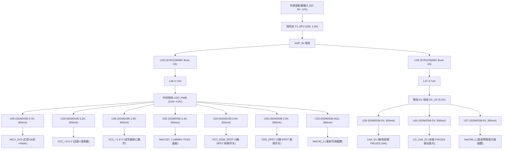

# UHF Reader 硬件电源树架构与 LDO 载流可靠性分析报告

## 一、 电源树架构（Power Tree Architecture）

本板卡采用 **“外部输入 -> 快速自恢复保险 -> 一级 Buck 开关稳压 -> 二级独立低噪 LDO 净化”** 的多级供电架构。针对射频敏感电路与数字高频电路进行了严密的电源隔离设计。

- **高清矢量拓扑图**：[`UHF_Reader_Power_Tree_Architecture.svg`](file:///C:/Users/ASUS/Desktop/coherent/basestation/02_硬件架构与拓扑图/UHF_Reader_Power_Tree_Architecture.svg)
- **Visio 可编辑工程**：[`电源树_Visio可编辑版.vsdx`](file:///C:/Users/ASUS/Desktop/coherent/basestation/02_硬件架构与拓扑图/电源树_Visio可编辑版.vsdx)

---

## 二、 各级 LDO 载流能力与工作可靠性核算

全板二级稳压芯片统一选用圣邦微（SGMICRO）**SGM2036 系列**（SOT-23-5 封装），其关键电气指标为：
- **最大额定持续输出电流 ($I_{max}$)**：**300 mA**
- **典型压差 ($V_{dropout}$)**：$165\text{ mV} @ 100\text{ mA}$，$300\text{ mV} @ 300\text{ mA}$
- **PSRR（电源抑制比）**：$75\text{ dB} @ 1\text{ kHz}$
- **封装热阻 ($R_{\theta JA}$)**：约 $200^\circ\text{C/W}$

下表基于各负载芯片规格书，详细列出各路 LDO 的电流预算、负载率与热耗裕量：

| 位号 | LDO 型号 | 输入轨 | 输出轨 | 目标负载芯片与功能说明 | 实际最大电流 | 额定电流 | 负载率 | 压差与功耗 | 评估结论 |
| :--- | :--- | :--- | :--- | :--- | :--- | :--- | :--- | :--- | :--- |
| **U30** | SGM2036-3.3V | LDO_PWR (3.9V) | `MCU_3V3` | 主控 `FM15F366` (<70mA) + 从机 `GD32E232` (15~20mA) + QSPI Flash (10mA) | **~100 mA** | 300 mA | **33.3%** | $\Delta V \approx 0.6V$, $P_D \approx 60\text{ mW}$ | **极安全**，发热极小 |
| **U29** | SGM2036-3.3V | LDO_PWR (3.9V) | `VCC_+3.3 V` | 精密运放 `TPH2502` (两路 ~15mA) + 无源混频 `HGC550` (0mA) + 数控衰减器 (uA级) + 射频模拟外设 | **~80 mA** | 300 mA | **26.7%** | $\Delta V \approx 0.6V$, $P_D \approx 48\text{ mW}$ | **极安全**，低噪稳定 |
| **U35** | SGM2036-1.8V | LDO_PWR (3.9V) | `VCC_+1.8 V` | 读写器基带 `FM13RD1616E` 内部核心数字逻辑 `VDD_DIG` 与预驱缓冲 | **~150 mA** | 300 mA | **50.0%** | $\Delta V \approx 2.1V$, $P_D \approx 315\text{ mW}$ | **安全**，温升约 60℃，建议保留底层散热地孔 |
| **U32** | SGM2036-3.3V | LDO_PWR (3.9V) | `NetC207_1` | 48MHz 高精度温补晶振（TCXO，典型 3~5mA，最大 23mA）通过 L4 供电 | **~10 mA** | 300 mA | **3.3%** | $\Delta V \approx 0.6V$, $P_D \approx 6\text{ mW}$ | **极优**，97% 裕量 |
| **U34** | SGM2036-2.8V | LDO_PWR (3.9V) | `VCC_SGM_SPDT` | 4 颗 SPDT 射频开关（U13, U14, U22, U23，单颗静态工作电流 $< 25\text{ \mu A}$） | **< 1 mA** | 300 mA | **< 0.5%** | $\Delta V \approx 1.1V$, $P_D \approx 1\text{ mW}$ | **极充沛**，几乎无温升 |
| **U36** | SGM2036-2.8V | LDO_PWR (3.9V) | `VDD_DPDT` | 3 颗 DPDT 射频切换开关（U10, U11, U12，单颗静态工作电流 $< 50\text{ \mu A}$） | **< 1 mA** | 300 mA | **< 0.5%** | $\Delta V \approx 1.1V$, $P_D \approx 1\text{ mW}$ | **极充沛**，几乎无温升 |
| **U33** | SGM2036-ADJ | LDO_PWR (3.9V) | `NetC92_2` | 发射链路增益控制偏置调节（受 `TX_EN` 信号硬件开关使能） | **~30 mA** | 300 mA | **10.0%** | $\Delta V \approx 1.0V$, $P_D \approx 30\text{ mW}$ | **安全** |
| **U26** | SGM2036-5V | DC_5V (5.0V) | `LNA_5V` | 接收前端 `FW1103` 低噪放（单级工作电流 $Idd = 65\text{ mA}$，两级合流 $\approx 130\text{ mA}$，受 MCU GPIO 使能） | **~130 mA** | 300 mA | **43.3%** | 滤波稳压，$\Delta V \le 0.2V$, $P_D \approx 26\text{ mW}$ | **安全**，独立隔离 |
| **U31** | SGM2036-5V | DC_5V (5.0V) | `LO_LNA_5V` | 本振驱动放大器（U16, U21，两级合流 $\approx 130\text{ mA}$）常开低噪供电 | **~130 mA** | 300 mA | **43.3%** | 滤波稳压，$\Delta V \le 0.2V$, $P_D \approx 26\text{ mW}$ | **安全**，独立隔离 |
| **U27** | SGM2036-5V | DC_5V (5.0V) | `NetC89_2` | 发射驱动放大级偏置（受 `TX_EN` 硬件使能） | **~65 mA** | 300 mA | **21.7%** | $\Delta V \le 0.2V$, $P_D \approx 13\text{ mW}$ | **安全** |

---

## 三、 前级 Buck DC-DC 与总保险丝能力核算

1. **U25 (SY8121BABC Buck 降压)**：
   - 额定输出电流：**2.0 A**
   - 下游总负载（LDO_PWR 支路）：$100\text{ mA} + 80\text{ mA} + 150\text{ mA} + 10\text{ mA} + 1\text{ mA} + 1\text{ mA} + 30\text{ mA} \approx \mathbf{372\text{ mA}}$
   - **负载率仅 18.6%**（拥有 **81.4% 的超额设计裕量**），工作效率 $> 92\%$，发热极低。
2. **U28 (SY8121BABC Buck 降压)**：
   - 额定输出电流：**2.0 A**
   - 下游总负载（DC_5V 支路）：$130\text{ mA} + 130\text{ mA} + 65\text{ mA} \approx \mathbf{325\text{ mA}}$
   - **负载率仅 16.3%**（拥有 **83.7% 的超额设计裕量**），转换效率高，性能极为稳定。
3. **输入自恢复保险 F1 (JFC1206-1300FS)**：
   - 额定电流：**1.3 A**
   - 12V 供电时，全板总功率约 $3.7\text{W}$，输入端总电流仅约为 **$0.31\text{ A}$**，仅占保险丝额定载流能力的 $23.8\%$，完全避免误熔断。

---

## 四、 核心工程评估结论

1. **载流能力结论**：**当前设计的全部 10 颗 LDO 均能完全、正常且稳定地保障所有下游元器件工作**。最大负载支路（读写器 1.8V 核心与双 LNA 5V 支路）负载率最高仅为 50%，均在芯片 datasheet 推荐的最佳线性工作区内。
2. **压差与发热设计精妙**：系统未直接用 12V 降压给 3.3V/1.8V LDO，而是先通过高效开关稳压器 U25 降压至中间母线 `LDO_PWR`（约 3.9V），再分配给各 3.3V/2.8V/1.8V LDO。这种“二级稳压”架构将线性稳压器的压差控制在 $0.6\text{V} \sim 2.1\text{V}$，彻底解决了传统线性稳压器的大发热问题。
3. **射频与抗干扰设计达标**：针对高频接收（`LNA_5V`）、本振参考（`LO_LNA_5V`）、高灵敏度温补晶振（`NetC207_1`）和数字处理（`MCU_3V3`）进行了独立的物理 LDO 分立隔离，有效切断了数字开关噪声与射频通路的传导耦合路径。
